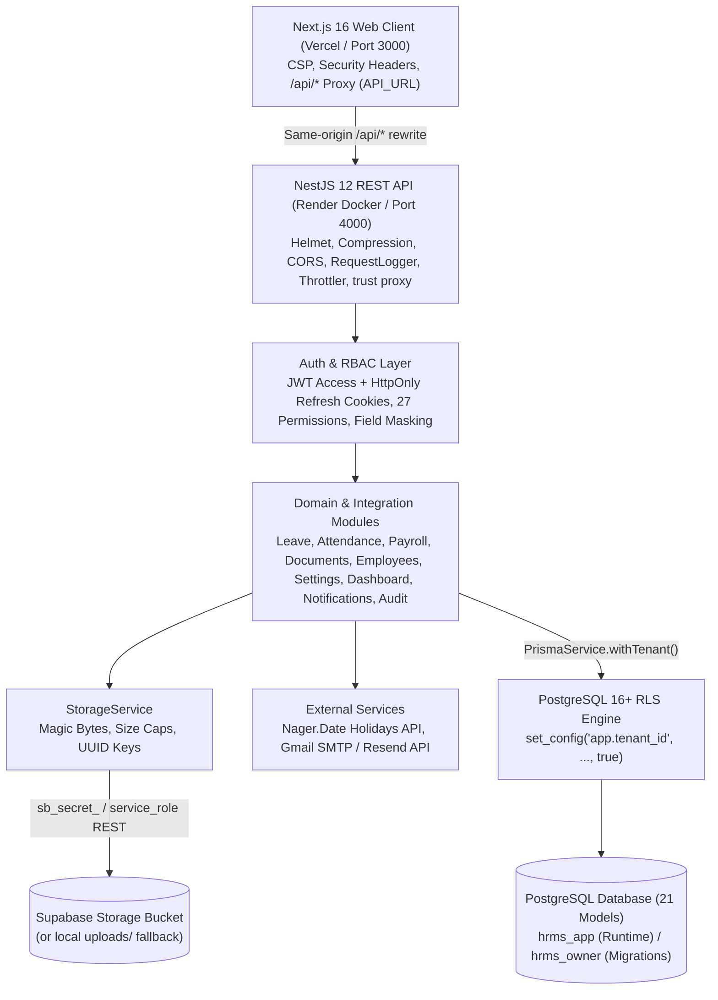

# System Architecture & Technical Specifications

**Azir Company Global Tech (ACGT)** — Enterprise Multi-Tenant Human Resources Management System (HRMS) with Philippine Labor Law Compliance, PostgreSQL Row-Level Security (RLS), Cloud Object Storage, and CI/CD Automation.

---

## 1. High-Level Architecture



---

## 2. Multi-Tenancy via PostgreSQL Row-Level Security (RLS)

Tenant isolation is enforced inside the PostgreSQL query planner rather than relying solely on application `WHERE` clauses.

### Dual-Role Database Architecture
- **`hrms_owner` (`OWNER_DATABASE_URL` / `DATABASE_URL`):** Table owner role used by Prisma CLI (`prisma migrate deploy`, `prisma db seed`).
- **`hrms_app` (`APP_DATABASE_URL`):** Non-superuser runtime application role (`NOBYPASSRLS`) used by `PrismaService`. Explicitly granted DML privileges (`SELECT`, `INSERT`, `UPDATE`, `DELETE`) across tenant tables, with `UPDATE` and `DELETE` revoked on `"AuditLog"`.
  - For fresh cloud Postgres instances (such as Supabase), `apps/api/prisma/supabase-init.sql` creates `hrms_app` idempotently prior to running migrations.

### Transaction-Scoped Tenant Context
Every tenant-scoped operation executes inside `PrismaService.withTenant(tenantId, fn)` (`apps/api/src/prisma/prisma.service.ts`):
```typescript
return this.$transaction(async (tx) => {
  await tx.$executeRaw`SELECT set_config('app.tenant_id', ${tenantId}, true)`;
  return fn(tx);
});
```
RLS policies match rows against `NULLIF(current_setting('app.tenant_id', true), '')::uuid`. Cross-tenant authentication lookups and public document certificate verifications use strictly scoped `SECURITY DEFINER` SQL functions (`app_login_lookup(email)` and `app_verify_document(code)`).

---

## 3. Domain Subsystems (`12` Modules + `HealthController`)

1. **Auth & RBAC (`apps/api/src/auth`):**
   - `15m` Bearer access tokens + `7d` `httpOnly`, `SameSite=Lax`, `Secure` (in production) refresh cookies.
   - `jwt-secrets.ts` enforces fail-closed secret requirements when `NODE_ENV=production`.
   - `Roles` (`EMPLOYEE`, `MANAGER`, `HR`, `ADMIN`) expand to `27` granular permissions checked globally by `JwtAuthGuard` and `PermissionsGuard`.
2. **Employees & Compensation Field Masking (`apps/api/src/employees`):**
   - Self-service profile (`/me/profile`), avatar upload/removal (`/me/avatar`), and organization hierarchy.
   - `EmployeesService` omits `basicSalary` and `allowances` unless the requester is `isSelf` or holds `employee.write` / `payroll.view.all`.
3. **Philippine Statutory Leave & Double-Entry Ledger (`apps/api/src/leave`):**
   - Pure deterministic rules in `Asia/Manila` timezone (`leave-rules.ts`): SIL (Art. 95, `>= 12` months service), Maternity (RA 11210, 105 calendar days), Paternity (RA 8187, 7 working days), VL, and SL.
   - Immutable append-only `LeaveLedgerEntry` (`GRANT`, `DEDUCT`, `ADJUST`) computes live available balances; `FOR UPDATE` row locking prevents overlap race conditions.
4. **Attendance, DTR & Official Business (`apps/api/src/attendance`):**
   - Timezone-aware punches (`OFFICE`, `FIELD_CLIENT_SITE`, `REMOTE_WFH`), 9:00 AM – 6:00 PM shift with 15-minute grace window, minute-rate tardiness/undertime deductions, and 1-step manager approval for OB/missed punches.
5. **Philippine Statutory Payroll (`apps/api/src/payroll`):**
   - Semi-monthly payroll periods & runs computing SSS, PhilHealth, Pag-IBIG (HDMF), and BIR TRAIN withholding taxes, integrated with unpaid leaves, attendance penalties, `1.25x` overtime, and `PayrollAdjustment` lines.
6. **Verifiable HR Documents (`apps/api/src/documents`):**
   - COE, COE with Compensation, Leave Certification, and Certified Payslip requests with DOLE SLA tracking, unique verification codes, and public `/verify/[code]` QR lookup.
7. **Cloud Object Storage (`apps/api/src/storage`):**
   - Magic-byte verification (`JPEG`, `PNG`, `WEBP`, `PDF`), category size caps (`2 MB` avatars, `5 MB` leave attachments), UUID object keys, path-traversal checks, `X-Content-Type-Options: nosniff`, tenant-prefix guard on `/storage/download`, and Supabase Storage REST (`sb_secret_` + legacy JWT support) with local disk fallback.
8. **External APIs & Notifications (`apps/api/src/settings`, `apps/api/src/notifications`):**
   - Nager.Date Philippine Public Holidays preview & sync (`2000–2100` bounds).
   - Gmail SMTP (`nodemailer`) primary + Resend HTTP API fallback + `EMAIL_DEMO_OVERRIDE` for `.test`/`.local` accounts + `LOG_ONLY` fallback.
9. **Audit Trail & Health (`apps/api/src/audit`, `apps/api/src/health.controller.ts`):**
   - Immutable before/after JSON mutation snapshots in `AuditLog`.
   - `/health` liveness endpoint and `/health/ready` database readiness check (`SELECT 1`).

---

## 4. Security & Proxy Topology

- **API Security (`apps/api/src/app.setup.ts`):** Express `trust proxy` (`1` hop), `helmet()`, `compression()`, strict `APP_WEB_URL` CORS, `RequestLoggerMiddleware` (without headers/body/secrets logging), global `ValidationPipe` (`whitelist`, `forbidNonWhitelisted`, `transform`), and route throttling (`120/min` global, `15/min` auth, `10/min` email).
- **Web Security & Cookie Proxy (`apps/web/next.config.ts`):** Applies `X-Frame-Options: DENY`, `X-Content-Type-Options: nosniff`, `Referrer-Policy`, `Permissions-Policy`, and `Content-Security-Policy` headers, and proxies `/api/*` via server-side `API_URL` (`resolveApiProxyTarget`) so authentication refresh cookies remain same-origin across Vercel and Render.
