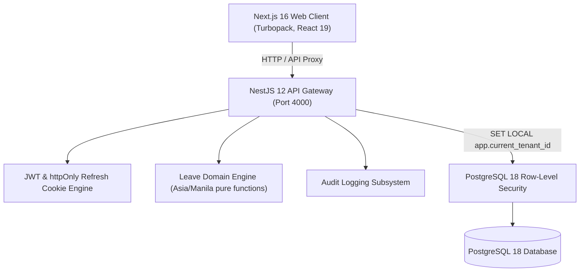

# System Architecture & Technical Specifications

Enterprise Multi-Tenant Human Resources Management System (HRMS) with Philippine Labor Law Compliance.

---

## 1. High-Level Architecture



---

## 2. Multi-Tenancy via PostgreSQL Row-Level Security (RLS)

Multi-tenancy is enforced directly inside the PostgreSQL query planner, rather than relying on application-level filtering.

### Dual-Role Database Configuration:
- **`hrms_owner`:** Superuser / table owner role used during schema migrations (`prisma migrate`) and database seed operations. Has `BYPASSRLS`.
- **`hrms_app`:** Application role used exclusively by the NestJS runtime. Has `NOBYPASSRLS` and standard DML privileges (`SELECT`, `INSERT`, `UPDATE`, `DELETE`).

### RLS Policies:
Every table with a `tenantId` column enforces Row-Level Security:
```sql
ALTER TABLE "Employee" ENABLE ROW LEVEL SECURITY;
ALTER TABLE "Employee" FORCE ROW LEVEL SECURITY;

CREATE POLICY "tenant_isolation_policy" ON "Employee"
    FOR ALL
    USING ("tenantId" = NULLIF(current_setting('app.current_tenant_id', true), '')::uuid);
```

### Transaction Scoping:
All queries run inside a transaction client using `PrismaService.withTenant`:
```typescript
await tx.$executeRawUnsafe(
  `SET LOCAL app.current_tenant_id = '${tenantId.replace(/'/g, "''")}';`
);
```

---

## 3. Philippine Labor Law Compliance Engine

The leave calculation subsystem resides in `apps/api/src/leave/leave-rules.ts` as **pure, deterministic functions** operating in `Asia/Manila` timezone:

1. **Service Incentive Leave (SIL - Labor Code Art. 95):**
   - 5 days annual entitlement.
   - Requires minimum 12 months tenure (`serviceMonths(hireDate, onDate) >= 12`).
2. **Maternity Leave (RA 11210):**
   - 105 calendar days for female employees, regardless of marital status.
3. **Paternity Leave (RA 8187):**
   - 7 working days for married male employees.
4. **Working Day Calculation:**
   - Excludes Sundays and Philippine National Holidays (Regular and Special Non-Working).
   - Calendar day counting mode applies to Maternity Leave.

---

## 4. Double-Entry Leave Ledger

Balances are stored as append-only immutable transactions in `LeaveLedgerEntry`:
- **`GRANT`:** Annual statutory quota allocations.
- **`DEDUCT`:** Deductions upon 2-step leave approval completion.
- **`ADJUST`:** Manual adjustments by HR administrators with audit trail.

**Net Available Formula:**
$$\text{Available} = \max(0, \sum \text{Ledger Days} - \sum \text{Pending Approval Days})$$

---

## 5. Role-Based Access Control (RBAC) Matrix

| Permission | EMPLOYEE | MANAGER | HR | ADMIN |
|:---|:---:|:---:|:---:|:---:|
| `leave.file` | ✅ | ✅ | ✅ | ✅ |
| `leave.approve.manager` | ❌ | ✅ | ❌ | ❌ |
| `leave.approve.hr` | ❌ | ❌ | ✅ | ❌ |
| `team.read` | ❌ | ✅ | ❌ | ❌ |
| `employee.read.all` | ❌ | ❌ | ✅ | ✅ |
| `employee.write` | ❌ | ❌ | ✅ | ❌ |
| `balance.adjust` | ❌ | ❌ | ✅ | ❌ |
| `department.write` | ❌ | ❌ | ❌ | ✅ |
| `leaveType.write` | ❌ | ❌ | ❌ | ✅ |
| `holiday.write` | ❌ | ❌ | ❌ | ✅ |
| `role.assign` | ❌ | ❌ | ❌ | ✅ |
| `audit.read` | ❌ | ❌ | ✅ | ✅ |

---

## 6. Safe Soft-Deactivation Policy

To protect referential integrity and historical compliance:
- Departments and Leave Types that have existing references (filings, ledger entries, or assigned employees) are **deactivated** (`active = false`) instead of hard deleted.
- Deactivated leave policies can no longer be filed by employees.
- Deactivated departments no longer appear in new employee assignment options, but historical employment records retain their link.
