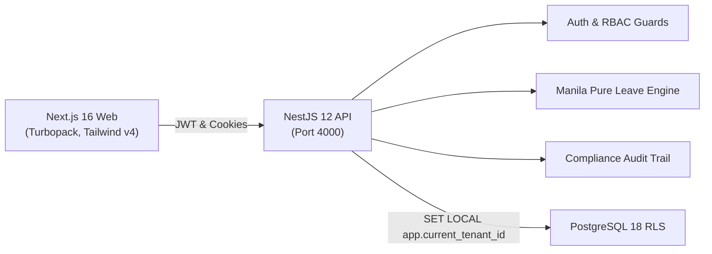

# 🏢 Enterprise Multi-Tenant Human Resources Management System (HRMS)

A production-grade, multi-tenant Human Resources Management System specialized for **Philippine Labor Law Statutory Leave Compliance** with database-level isolation enforced by **PostgreSQL Row-Level Security (RLS)**.

Built with **Next.js 16 (App Router)**, **NestJS 12**, **Prisma ORM**, **PostgreSQL 18**, and **Tailwind CSS v4** in a strictly monochrome black & white design system.

---

## ⚡ Quick Start & Setup

### Prerequisites
- Node.js 20+
- pnpm 9+
- PostgreSQL 16+ (running locally on port 5432)

### 1. Installation
```bash
# Clone the repository
git clone https://github.com/your-username/HumanResources-Management-System.git
cd HumanResources-Management-System

# Install dependencies
pnpm install
```

### 2. Database Dual-Role Initialization
Ensure your local PostgreSQL service has the database roles configured:
```bash
# Run PostgreSQL dual-role setup (creates hrms_owner and hrms_app)
psql -U postgres -f packages/db/setup.sql
```

### 3. Reset & Seed Test Data
Seeds 2 isolated tenant corporations (Acme Manila Corp & Bayanihan Foods), 17 employees across 4 roles, 2026 Philippine national holidays, and initial balance ledgers:
```bash
pnpm db:reset
```

### 4. Start Development Servers
```bash
pnpm dev
```
- **Web Portal:** [http://localhost:3000](http://localhost:3000)
- **API Server:** [http://localhost:4000](http://localhost:4000)

---

## 👥 Demo Accounts (1-Click Login Available)

All demo accounts use the default password: **`Demo1234!`**

| User / Persona | Email | Roles | Access Level & Key Capabilities |
|:---|:---|:---|:---|
| **Maria Santos** | `employee@acme.test` | `EMPLOYEE` | Files statutory leave (SIL, Maternity, VL, SL), checks balance ledger, views personal profile. |
| **Juan Dela Cruz** | `manager@acme.test` | `MANAGER`, `EMPLOYEE` | Step 1 leave approver, direct reports overview (`/team`), reviews team out-of-office schedule. |
| **Anna Reyes** | `hr@acme.test` | `HR`, `EMPLOYEE` | Step 2 final leave approver, annual balance grant runner, manual balance adjustments, employee directory management. |
| **Carlos Tan** | `admin@acme.test` | `ADMIN`, `EMPLOYEE` | Company Admin with organization settings management (policies, holidays, departments), role assignment, and audit logs. |

---

## 🇵🇭 Philippine Statutory Leave Compliance Rules

The leave engine is implemented in `apps/api/src/leave/leave-rules.ts` as deterministic pure functions operating in `Asia/Manila` timezone:

1. **Service Incentive Leave (SIL - Labor Code Art. 95):**
   - 5 working days per year for employees with at least 1 year (12 months) of service.
2. **Maternity Leave (RA 11210 / 105-Day Expanded Maternity Leave Act):**
   - 105 calendar days for female employees, regardless of marital status.
3. **Paternity Leave (RA 8187):**
   - 7 working days for married male employees for up to 4 deliveries of legitimate spouse.
4. **Vacation Leave (VL) & Sick Leave (SL):**
   - 10 days each, available immediately upon tenure.
5. **Holiday & Working Day Calculations:**
   - Excludes Sundays and Philippine National Holidays (Regular and Special Non-Working).

---

## 🏛️ Architecture Highlights



- **PostgreSQL Row-Level Security (RLS):** True engine-level multi-tenancy. Standard web queries run under `hrms_app` which cannot read or write data belonging to another tenant even if an application query lacks `WHERE tenantId`.
- **Double-Entry Leave Ledger:** Balances are not stored as mutable integers; they are dynamically computed from an append-only ledger (`GRANT`, `DEDUCT`, `ADJUST`).
- **Two-Step Approval Flow:** Employee submits → Direct Manager approves (Step 1) → HR Administrator confirms (Step 2) → Ledger atomically deducted.
- **Optimistic Concurrency Control:** Row-version state matching prevents race conditions and over-allocation (returns `409 Conflict`).
- **Safe Soft-Deactivation:** In-use departments and leave types are deactivated rather than deleted, preserving referential integrity and audit records.
- **Compliance Audit Logging:** All mutations record before/after JSON states with user identity and timestamp.

---

## 🧪 Testing & Verification

Run the comprehensive test suite across the monorepo:

```bash
# Run API Unit Tests (14 passed)
pnpm --filter api test

# Run API End-to-End Tests (70 passed across 11 test suites)
pnpm --filter api test:e2e

# Run Web Next.js Production Build (17 routes verified)
pnpm --filter web build
```

---

## 📄 Documentation Links
- [System Architecture & Specifications](file:///C:/HumanResources-Management-System/ARCHITECTURE.md)
- [5-Minute Capstone Demo Presentation Script](file:///C:/HumanResources-Management-System/docs/demo-script.md)
- [Architecture Decision Records (ADRs)](file:///C:/HumanResources-Management-System/docs/decisions/)
