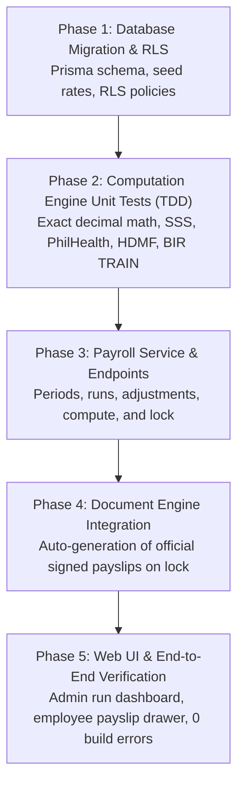

# Feature 2 Specification: Complete Payroll & Attendance Adjustments

**Project:** Multi-Tenant Human Resources Management System (HRMS)  
**Target Milestone:** Friday, November 20, 2026 Presentation  
**Design Standards:** Spec-Driven Development (SDD) & Test-Driven Development (TDD)  
**Tenant Isolation:** PostgreSQL Row-Level Security (RLS) + Multi-Tenant `tenant_id`  

---

## 1. Executive Summary

Feature 2 completes the core HR lifecycle by connecting **Employee Profiles**, **Leave Tracking**, and **Philippine Statutory Payroll Computation** with the **Document Engine (Feature 1)**.

### The Problem It Solves
1. **Attendance-to-Payroll Disconnect**: Leave approvals currently exist in isolation; unpaid leaves must accurately deduct from gross pay without manual recalculation errors.
2. **Philippine Statutory Compliance**: Philippine labor law requires precise computation of mandatory contributions (SSS, PhilHealth, Pag-IBIG HDMF) and BIR withholding tax (TRAIN Law) using exact decimal arithmetic.
3. **Automated Payslip Distribution**: Once HR approves and locks a payroll run, verifiable tamper-proof payslips must automatically unlock in each employee's self-service portal, complete with verification QR codes and the official HR signature.

---

## 2. Core Entities & Database Schema

All tables inherit tenant isolation via `tenantId UUID` with PostgreSQL Row-Level Security (`current_setting('app.tenant_id')::uuid`).

### 2.1 Prisma Schema Modifications

```prisma
// Extension to existing Employee model
model Employee {
  // ... existing fields ...
  basicSalary       Decimal             @default(30000.00) @db.Decimal(12, 2)
  allowances        Decimal             @default(2000.00) @db.Decimal(12, 2)
  payrollItems      PayrollItem[]
  payrollAdjustments PayrollAdjustment[]
  preparedRuns      PayrollRun[]        @relation("PreparedBy")
  approvedRuns      PayrollRun[]        @relation("ApprovedBy")
}

enum PayrollPeriodType {
  FIRST_HALF      // 1st to 15th
  SECOND_HALF     // 16th to end of month
  MONTHLY
}

enum PayrollRunStatus {
  DRAFT           // Created, accepting adjustments
  COMPUTED        // Calculations run, awaiting review
  APPROVED        // Approved by authorized HR/Admin
  LOCKED          // Frozen, immutable, payslips issued
  PAID            // Disbursed
}

enum AdjustmentType {
  OVERTIME_HOURS  // In hours, auto-computed via hourly rate * 1.25
  BONUS           // Direct earning amount
  ALLOWANCE       // Non-taxable or taxable addition
  DEDUCTION       // Manual salary deduction
}

enum LineCategory {
  EARNING
  DEDUCTION
  EMPLOYER_CONTRIBUTION
}

model PayrollPeriod {
  id              String            @id @default(uuid()) @db.Uuid
  tenantId        String            @db.Uuid
  name            String            // e.g. "November 2026 - First Half"
  cutoffType      PayrollPeriodType @default(FIRST_HALF)
  startDate       DateTime          @db.Date
  endDate         DateTime          @db.Date
  payDate         DateTime          @db.Date
  workingDays     Int               @default(11)
  createdAt       DateTime          @default(now())
  updatedAt       DateTime          @updatedAt
  tenant          Tenant            @relation(fields: [tenantId], references: [id], onDelete: Cascade)
  payrollRuns     PayrollRun[]

  @@unique([tenantId, startDate, endDate])
  @@index([tenantId, startDate])
}

model PayrollRun {
  id                          String              @id @default(uuid()) @db.Uuid
  tenantId                    String              @db.Uuid
  payrollPeriodId             String              @db.Uuid
  runNumber                   String              // e.g. "PR-2026-11-1"
  status                      PayrollRunStatus    @default(DRAFT)
  totalGross                  Decimal             @default(0.00) @db.Decimal(14, 2)
  totalDeductions             Decimal             @default(0.00) @db.Decimal(14, 2)
  totalNet                    Decimal             @default(0.00) @db.Decimal(14, 2)
  totalEmployeeContributions  Decimal             @default(0.00) @db.Decimal(14, 2)
  totalEmployerContributions  Decimal             @default(0.00) @db.Decimal(14, 2)
  preparedById                String              @db.Uuid
  approvedById                String?             @db.Uuid
  approvedAt                  DateTime?
  lockedAt                    DateTime?
  createdAt                   DateTime            @default(now())
  updatedAt                   DateTime            @updatedAt

  tenant                      Tenant              @relation(fields: [tenantId], references: [id], onDelete: Cascade)
  payrollPeriod               PayrollPeriod       @relation(fields: [payrollPeriodId], references: [id], onDelete: Restrict)
  preparedBy                  Employee            @relation("PreparedBy", fields: [preparedById], references: [id])
  approvedBy                  Employee?           @relation("ApprovedBy", fields: [approvedById], references: [id])
  items                       PayrollItem[]
  adjustments                 PayrollAdjustment[]

  @@unique([tenantId, runNumber])
  @@index([tenantId, status])
}

model PayrollItem {
  id                  String            @id @default(uuid()) @db.Uuid
  tenantId            String            @db.Uuid
  payrollRunId        String            @db.Uuid
  employeeId          String            @db.Uuid
  basicPay            Decimal           @db.Decimal(12, 2)
  allowances          Decimal           @default(0.00) @db.Decimal(12, 2)
  overtimePay         Decimal           @default(0.00) @db.Decimal(12, 2)
  absencesDeduction   Decimal           @default(0.00) @db.Decimal(12, 2)
  grossPay            Decimal           @db.Decimal(12, 2)
  sssEe               Decimal           @default(0.00) @db.Decimal(10, 2)
  sssEr               Decimal           @default(0.00) @db.Decimal(10, 2)
  philHealthEe        Decimal           @default(0.00) @db.Decimal(10, 2)
  philHealthEr        Decimal           @default(0.00) @db.Decimal(10, 2)
  pagIbigEe           Decimal           @default(0.00) @db.Decimal(10, 2)
  pagIbigEr           Decimal           @default(0.00) @db.Decimal(10, 2)
  withholdingTax      Decimal           @default(0.00) @db.Decimal(10, 2)
  otherDeductions     Decimal           @default(0.00) @db.Decimal(10, 2)
  netPay              Decimal           @db.Decimal(12, 2)
  issuedDocumentId    String?           @db.Uuid

  tenant              Tenant            @relation(fields: [tenantId], references: [id], onDelete: Cascade)
  payrollRun          PayrollRun        @relation(fields: [payrollRunId], references: [id], onDelete: Cascade)
  employee            Employee          @relation(fields: [employeeId], references: [id], onDelete: Restrict)
  lines               PayrollItemLine[]

  @@unique([payrollRunId, employeeId])
  @@index([tenantId, employeeId])
}

model PayrollItemLine {
  id              String        @id @default(uuid()) @db.Uuid
  tenantId        String        @db.Uuid
  payrollItemId   String        @db.Uuid
  category        LineCategory
  code            String        // BASIC, ALLOWANCE, OVERTIME, SSS_EE, PHILHEALTH_EE, PAGIBIG_EE, TAX, ABSENCE
  description     String
  amount          Decimal       @db.Decimal(10, 2)
  rate            Decimal?      @db.Decimal(10, 2)
  quantity        Decimal?      @db.Decimal(8, 2)

  tenant          Tenant        @relation(fields: [tenantId], references: [id], onDelete: Cascade)
  payrollItem     PayrollItem   @relation(fields: [payrollItemId], references: [id], onDelete: Cascade)

  @@index([payrollItemId])
}

model PayrollAdjustment {
  id              String          @id @default(uuid()) @db.Uuid
  tenantId        String          @db.Uuid
  payrollRunId    String          @db.Uuid
  employeeId      String          @db.Uuid
  type            AdjustmentType
  description     String
  amount          Decimal         @db.Decimal(10, 2)
  quantity        Decimal?        @db.Decimal(8, 2) // e.g. overtime hours
  createdAt       DateTime        @default(now())

  tenant          Tenant          @relation(fields: [tenantId], references: [id], onDelete: Cascade)
  payrollRun      PayrollRun      @relation(fields: [payrollRunId], references: [id], onDelete: Cascade)
  employee        Employee        @relation(fields: [employeeId], references: [id], onDelete: Cascade)

  @@index([payrollRunId, employeeId])
}
```

---

## 3. Philippine Payroll Computation Engine

All computations use exact `Decimal` precision to avoid binary floating-point roundoff errors.

### 3.1 Rate Derivations
- **Standard Working Factor**: 261 working days/year (Monday–Friday).
- **Daily Rate**: `(Basic Monthly Salary * 12) / 261`
- **Hourly Rate**: `Daily Rate / 8`
- **Semi-Monthly Cutoff Base**:
  - `Cutoff Basic = Basic Monthly Salary / 2`
  - `Cutoff Allowances = Monthly Allowances / 2`

### 3.2 Cutoff Working Days & Absence Deductions
1. Calculate working days between `startDate` and `endDate` excluding Saturdays and Sundays.
2. Exclude tenant regular/special holidays falling within the period (`Holiday` table).
3. Find approved leave requests overlapping the cutoff where `LeaveType.paid === false`.
4. Deduct: `Absences Deduction = unpaidLeaveDays * Daily Rate`.

### 3.3 Overtime Earnings
- Regular Workday Overtime: `Hourly Rate * 1.25 * Overtime Hours`.
- Stored as itemized `PayrollItemLine` records.

### 3.4 Philippine Statutory Deductions (Semi-Monthly Split)

#### 1. SSS (Social Security System)
- Monthly Salary Credit (MSC) capped at ₱35,000 (2025/2026 guidelines).
- Employee Share: ~4.5% of MSC.
- Semi-Monthly SSS Deduction: `(Monthly SSS Employee Share) / 2`.
- Exact lookup table mapped by MSC bracket.

#### 2. PhilHealth
- Premium rate: 5% of Basic Monthly Salary.
- Monthly salary floor: ₱10,000; Monthly ceiling: ₱100,000.
- Monthly Employee Share: `(basicSalary * 0.05) / 2`.
- Semi-Monthly Deduction: `(Monthly PhilHealth EE) / 2`.

#### 3. Pag-IBIG (HDMF)
- Statutory employee contribution: ₱200.00/month.
- Semi-Monthly Deduction: `₱100.00`.

#### 4. BIR Revised Withholding Tax (TRAIN Law - Semi-Monthly Brackets)
- **Taxable Net Pay**:
  `Taxable Income = Gross Pay - (SSS EE + PhilHealth EE + Pag-IBIG EE + Non-taxable Allowances)`
- **Tax Brackets (Semi-Monthly)**:
  | Taxable Income (Semi-Monthly) | Prescribed Tax Computation |
  |---|---|
  | ₱0.00 to ₱10,417.00 | ₱0.00 (Exempt) |
  | ₱10,417.01 to ₱16,667.00 | 15% of excess over ₱10,417 |
  | ₱16,667.01 to ₱33,333.00 | ₱937.50 + 20% of excess over ₱16,667 |
  | ₱33,333.01 to ₱83,333.00 | ₱4,270.70 + 25% of excess over ₱33,333 |
  | ₱83,333.01 to ₱333,333.00 | ₱16,770.70 + 30% of excess over ₱83,333 |
  | Over ₱333,333.00 | ₱91,770.70 + 35% of excess over ₱333,333 |

### 3.5 Net Take-Home Pay
$$\text{Gross Pay} = \text{Basic Pay} + \text{Allowances} + \text{Overtime Pay} - \text{Absences Deduction}$$
$$\text{Total Deductions} = \text{SSS EE} + \text{PhilHealth EE} + \text{Pag-IBIG EE} + \text{Withholding Tax} + \text{Manual Deductions}$$
$$\text{Net Pay} = \text{Gross Pay} - \text{Total Deductions}$$

---

## 4. API Specification & Workflow

### 4.1 Endpoints

| Method | Endpoint | Permission | Description |
|---|---|---|---|
| `GET` | `/payroll/periods` | `payroll.view` | List cutoff periods |
| `POST` | `/payroll/periods` | `payroll.manage` | Create new semi-monthly cutoff period |
| `GET` | `/payroll/runs` | `payroll.view` | List payroll runs with summary metrics |
| `POST` | `/payroll/runs` | `payroll.manage` | Initialize a payroll run for a period |
| `GET` | `/payroll/runs/:id` | `payroll.view` | Get run details, items, and status |
| `POST` | `/payroll/runs/:id/adjustments` | `payroll.manage` | Add overtime/bonus/deduction adjustment |
| `DELETE` | `/payroll/runs/:id/adjustments/:adjId` | `payroll.manage` | Remove adjustment |
| `POST` | `/payroll/runs/:id/compute` | `payroll.manage` | Compute/re-compute Gross to Net for all employees |
| `POST` | `/payroll/runs/:id/decision` | `payroll.approve` | Approve and Lock run (generates official payslips) |
| `GET` | `/payroll/my-payslips` | Authenticated | Employee self-service list of issued payslips |
| `GET` | `/payroll/my-payslips/:id` | Authenticated | View itemized payslip breakdown |

### 4.2 Anti-Self Approval & State Machine
1. **DRAFT**: Created by HR/Admin. HR inputs adjustments (overtime hours, bonuses).
2. **COMPUTED**: Triggered via `/compute`. System iterates all active employees, applies attendance rules and statutory formulas, and writes item lines.
3. **APPROVED & LOCKED**:
   - Authorized Admin/HR approves via `/decision`.
   - **Separation of Duties**: The user who prepared the run cannot be the sole approver if another HR/Admin exists.
   - Run becomes **IMMUTABLE**: No lines or adjustments can be edited.
   - System automatically generates a registered `IssuedDocument` (code: `PAYSLIP`) for every employee in the run with official doc number, QR verification code, and HR signature.

---

## 5. UI / UX Design

### 5.1 HR / Admin View (`/payroll`)
- **Metric Cards**: Total Disbursed Gross, Total Statutory Remittances, Net Take-Home, Employee Count.
- **Run Management**: Table of payroll periods with status badges (`Draft`, `Computed`, `Approved & Locked`).
- **Review & Adjustment Drawer**: Interactive modal showing computed rows with expandable breakdowns (Basic, OT, SSS, PhilHealth, Pag-IBIG, Tax, Net).
- **One-Click Lock & Issue**: Triggers batch payslip release.

### 5.2 Employee Self-Service View (`/payroll/my-payslips` and `/documents`)
- Displays payslips chronologically.
- Clicking any payslip opens the centered full-page official view with company logo, verification QR code, and transparent HR signature.
- Instant "Print / Save PDF" and offline self-contained HTML download.

---

## 6. Implementation & Verification Plan (TDD Phasing)



1. **Phase 1: Database & Seed Updates**:
   - Add Prisma models and relations with foreign keys and multi-tenant RLS.
   - Update demo seed with realistic salary baselines (₱28,000–₱65,000) and sample allowances.
2. **Phase 2: Math & Statutory Engine Unit Tests**:
   - Write unit tests with 5 hand-calculated standard Philippine employee profiles (entry-level, mid-level, high-earner, with overtime, with unpaid leaves).
3. **Phase 3: Controller & Integration Testing**:
   - Write E2E tests for run lifecycle: draft -> adjustment -> compute -> approve/lock.
4. **Phase 4: Payslip Auto-Generation Link**:
   - Test that locking a run generates verified `PAYSLIP` documents in the registry.
5. **Phase 5: Next.js Frontend & E2E Validation**:
   - Build `/payroll` dashboard and employee payslip view.
   - Run full 90+ test suite and production build verification.
